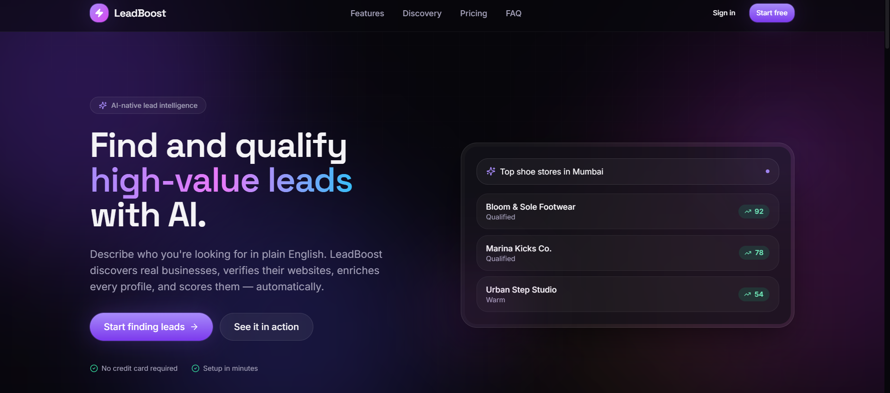
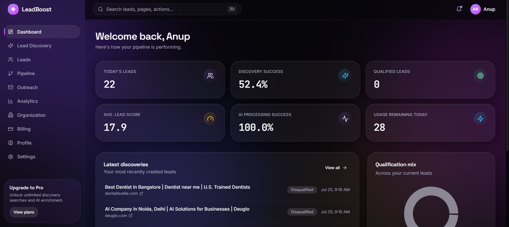
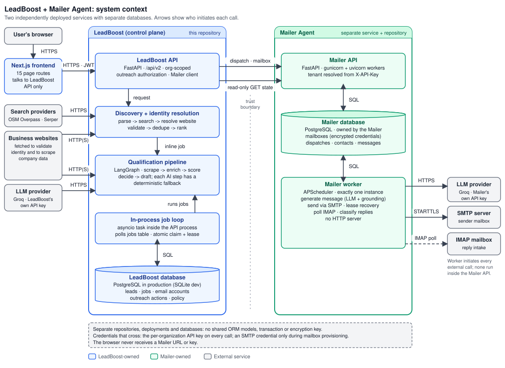
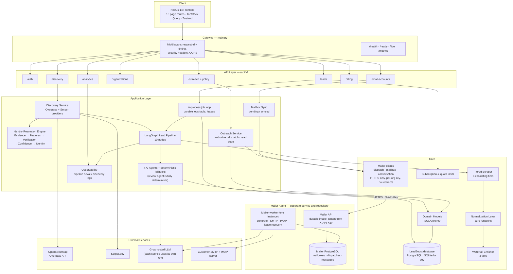
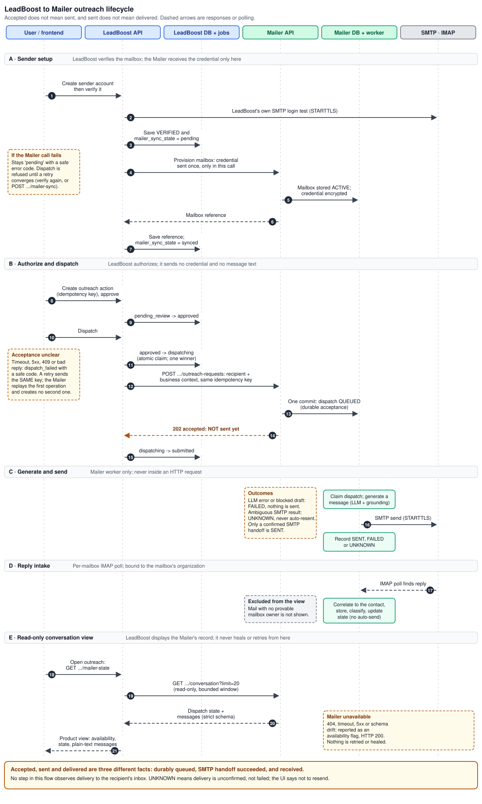
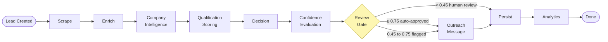

# LeadBoost

**Find, verify and qualify business leads from a plain-language query, then run approved outreach through a separately deployed Mailer Agent.**

[](https://github.com/anupamkr1708/LeadBoost-saas/actions/workflows/ci.yml)
[](LICENSE)


You type "top shoe stores in Mumbai". LeadBoost discovers candidate businesses, resolves and validates each
one's official website, removes duplicates, ranks the survivors, scrapes and enriches them, and scores them with a
LangGraph workflow in which every AI step has a deterministic fallback. When you decide to reach out, a verified
sender account is synchronized to the **Mailer Agent** (a separate service and repository), LeadBoost authorizes the
outreach, and the Mailer writes, sends and tracks the email conversation. LeadBoost shows the Mailer's delivery
state and replies back in the dashboard. Finding a lead never sends an email by itself.

| | |
|---|---|
|  |  |

## What it does

**1. Lead discovery and qualification**

* Natural-language business query, parsed deterministically.
* Candidate discovery from OpenStreetMap Overpass, with a Serper web-search fallback when Overpass finds nothing.
* Multi-stage **identity resolution** and official-website verification; directory and social profiles are rejected.
* Deduplication and deterministic, explainable ranking.
* Tiered scraping and a waterfall enrichment: deterministic first, an LLM only for what the evidence cannot answer.
* Qualification, scoring and a decision step; status and failures are persisted per lead.

**2. Approved outreach and communication**

* Verified sender account, synchronized to a Mailer-owned mailbox.
* LeadBoost authorizes an outreach action (manual approval, or automatic if the organization's policy allows it).
* Server-to-server dispatch to the Mailer; the Mailer durably accepts it, generates the message, and sends over SMTP.
* The Mailer polls the mailbox over IMAP, correlates replies to the conversation and classifies them.
* LeadBoost reads a **read-only** conversation and delivery-state view from the Mailer and shows a product-safe version.

The Mailer is a separate deployment with its own repository, database and encryption key:
[`LeadBoost-mail-agent`](https://github.com/anupamkr1708/LeadBoost-mail-agent). LeadBoost is the customer-facing
control plane; the Mailer owns the message it generates, mailbox execution and the authoritative delivery state.

## Architecture



In text: a **Next.js** frontend calls the **LeadBoost FastAPI** backend (`api → application → core`). Discovery and
identity resolution feed a **LangGraph** qualification workflow. Background work is a durable `jobs` table executed
by **one in-process job loop** inside the API process (no Celery or Redis queue is on the runtime path), backed by
PostgreSQL in production. LeadBoost calls the **Mailer API** over HTTPS with a per-organization key. The Mailer
runs as an API service plus **one worker** (message generation, SMTP sending, lease recovery, IMAP polling) on its
**own PostgreSQL**. The two services share no database, ORM model or encryption key, and the browser never talks to
the Mailer. Groq-hosted LLMs, Overpass and Serper, and the customer's SMTP and IMAP server are external.

### Layered view



More: [`ARCHITECTURE.md`](backend/docs/ARCHITECTURE.md) · [`ARCHITECTURE_FULL.md`](backend/docs/ARCHITECTURE_FULL.md) · [`SYSTEM_DESIGN.md`](backend/docs/SYSTEM_DESIGN.md) ·
[lifecycle](backend/docs/diagrams/leadboost-mailer-lifecycle.svg) · [state machines](backend/docs/diagrams/leadboost-outreach-state-machine.svg) ·
[deployment topology](backend/docs/diagrams/leadboost-deployment-topology.svg)

## Current workflow



The sequence above shows who calls whom after a lead is qualified. LeadBoost and the Mailer keep separate state
machines ([diagram](backend/docs/diagrams/leadboost-outreach-state-machine.svg)).

### End-to-end pipeline


Stages 1–10 run in LeadBoost (discovery, then the qualification workflow, which runs right to left in the second row).
Stages 11–12 set up the sender and authorize the outreach in LeadBoost, stages 13–14 run in the separate Mailer, and
stage 15 is LeadBoost's read-only view of the Mailer's state.

### Qualification pipeline (LangGraph)



Every node is wrapped so an exception is recorded on the run and degrades it to a partial result instead of crashing
it. The Review Gate is pure thresholding (no LLM; thresholds are configurable through `REVIEW_AUTO_APPROVE_THRESHOLD`
and `REVIEW_HUMAN_REVIEW_THRESHOLD`). Only low-confidence leads skip message generation. The drafted message is
LeadBoost's authorization snapshot; the Mailer writes the text that is actually sent.

## Engineering highlights

| Area | What it does | Trade-off |
|---|---|---|
| Identity resolution | Evidence → features → verification → confidence → resolved identity; competing website candidates and conflicts are scored, and nothing is fabricated when verification fails | Deterministic and testable, but no semantic judgement an LLM could add |
| Scraping and enrichment | Tiered scraping; enrichment waterfall (deterministic, then external API placeholder, then LLM as a last resort) | The external-API tier is not implemented |
| Ranking and qualification | Deterministic, explainable ranking; weighted scoring; AI steps with explicit deterministic fallbacks | Output quality drops, not availability, when a model is unavailable |
| Evaluation harness | 113 fixed queries run through the real discovery flow, with metrics, reports and unit tests | Measures automated success, not human-labeled accuracy |
| Service boundary | The Mailer is its own repository, database and process model | Two things to deploy and keep in agreement |
| Per-organization auth | One API key per LeadBoost organization; the Mailer alone maps key → tenant; no tenant id in bodies | Keys are operator-provisioned |
| Mailbox reconciliation | `pending`/`synced` flag flipped in the same commit as any relevant change; retryable | No cross-service transaction; short windows documented |
| Idempotent, durable dispatch | Same key replays at the Mailer; accepted work survives a crash | Does not make SMTP exactly-once |
| Lifecycle tests | Real LeadBoost API, a separate Mailer process, real SMTP/IMAP protocol against disposable servers | Not a real recipient inbox |
| Honest outcomes | `unknown` is never auto-resent; the conversation view is read-only, bounded and schema-validated | A person must decide what to do about `unknown` |

## Evaluation and testing

**Discovery benchmark.** `backend/discovery_eval/` holds 113 fixed queries. The committed report (generated
2026-08-04) found 581 businesses; website validation succeeded for 87.4% of them, a candidate website was resolved
for 88.8%, the duplicate rate was 1.4%, and every query parsed. Read these carefully:

* "Resolved" means a candidate website was found and passed validation. It is **not** a human-verified
  correctness rate; the manual-review sheet in `outputs/` is unlabeled.
* In that committed run every candidate was attributed to the Serper fallback.
* The corpus covers the categories and cities in `queries.py`, not production traffic.
* Definitions live in `discovery_eval/metrics.py`; the benchmark itself is run manually and never in CI.

**CI** ([workflow](.github/workflows/ci.yml)): formatting and lint (Black, Ruff, and a non-blocking Mypy), Alembic
migrations on PostgreSQL, backend unit tests, the cross-service E2E, a Docker build check, a non-blocking
dependency audit and a frontend lint and build. The badge above shows the current result; no static test count is
published.

**Cross-service lifecycle test.** It runs the real LeadBoost application and client against a Mailer checked out
at a pinned commit and run as its own process, using a disposable PostgreSQL database, a STARTTLS SMTP sink, a
throw-away Dovecot IMAP server and the Mailer's deterministic fake LLM. It covers sender verification, mailbox
sync, dispatch, generation, SMTP, an IMAP reply, correlation and the read-only conversation view.

**Verification levels.** Each level is reported separately; they are not interchangeable.

| Level | Scope | Status |
|---|---|---|
| CI-verified (synthetic) | The cross-service lifecycle test above | Runs in CI on pushes and pull requests to `main` and `develop`; no real recipient inbox is involved |
| Operator-reported (local) | End-to-end runs of the integrated system on a local setup | Reported by the operator; run records are not part of this repository |
| Operator-reported (hosted API) | The LeadBoost frontend and API and the Mailer API deployed as separate services and running | Reported by the operator; hostnames and hosting-console settings are intentionally not published |
| Operator-reported (hosted worker) | The Mailer worker deployed as its own single-instance service and running | Reported by the operator, recorded separately from the API |
| Hosted message delivery | Real email delivered to a recipient mailbox from the hosted deployment | No acceptance-test record (dispatch receipt and delivery evidence) is included, so delivery to a real inbox is not asserted |

## Getting started

Environment variables are documented once, in [`backend/docs/ENVIRONMENT.md`](backend/docs/ENVIRONMENT.md).

**Backend (Docker)**

```bash
cd backend
cp .env.example .env     # set SECRET_KEY; GROQ_API_KEY and SERPER_API_KEY are optional
docker compose up
```

**Backend (without Docker)**

```bash
cd backend
python -m venv .venv && source .venv/bin/activate
pip install -r requirements.txt
playwright install chromium    # only for the scraper's browser tier
export DATABASE_URL="sqlite:///./dev.db"
export SECRET_KEY="$(python -c 'import secrets; print(secrets.token_urlsafe(48))')"
uvicorn main:app --reload
```

**Frontend**

```bash
cd frontend-react
npm install
cp .env.example .env.local     # set NEXT_PUBLIC_API_URL to your backend
npm run dev                    # http://localhost:3000
```

**Unit tests.** This selects the same tests as the CI job "Backend unit tests", with the same environment:

```bash
cd backend
pip install -r requirements.txt pytest pytest-asyncio
playwright install chromium      # CI installs Chromium; browser-dependent tests need it
export DATABASE_URL="sqlite:///./ci_test.db" ENVIRONMENT=development
export SECRET_KEY="$(python -c 'import secrets; print(secrets.token_urlsafe(48))')"
pytest tests/ discovery_eval/tests/ --ignore=tests/scraper
```

`tests/e2e/` is collected by this command, but its cross-service tests skip themselves unless a Mailer checkout
is configured (`MAILER_REPO_PATH`), so locally they are skipped, not passed. CI runs them in a separate job with
the Mailer and extra services (see below).

**Discovery evaluation** (live provider calls; needs the relevant API keys)

```bash
cd backend
python -m discovery_eval.run_eval --limit 10    # smoke run; omit --limit for all 113 queries
```

The run writes its report into `discovery_eval/outputs/`, **overwriting the committed benchmark files** that the
numbers above come from; restore them with `git checkout` if you only wanted a smoke test.

**Cross-service integration tests** need a checkout of the Mailer (CI pins one commit), a separate virtualenv for
it, Dovecot and root for the lifecycle test, and a *disposable* PostgreSQL database named `mailer_agent_test` on
loopback. The lifecycle
test creates and drops data in that database, so it refuses to run unless `C12_ALLOW_DESTRUCTIVE_TEST_DB=1` is set
and the database name matches. Never point it at a real database. The exact CI steps are the reference:
[`.github/workflows/ci.yml`](.github/workflows/ci.yml), job "Cross-service E2E".

## Known limitations

* **Discovery quality is measured as automated success**, not human-labeled accuracy (see above).
* **Execution model.** The job loop runs inside the single API process, and discovery runs inside the request. The
  Mailer worker is a single instance. Neither scales out yet.
* **Delivery.** `sent` means the SMTP server accepted the message, not that it reached an inbox; no component
  observes inbox delivery. SMTP is not exactly-once, so ambiguous outcomes are `unknown` and never auto-resent.
* **A crashed dispatch** can leave a LeadBoost action in `dispatching` with no automatic reclaim, and LeadBoost
  does not heal its state from the Mailer's.
* **Mailer scope.** STARTTLS only (no implicit TLS); the display name and sender organization are deployment-wide;
  IMAP settings are configured through the Mailer API; mail with no provable mailbox owner is excluded from the
  view; the Mailer does not auto-follow-up or auto-reply to LeadBoost-authorized contacts, so a further email needs
  a new authorized action.
* **Enrichment.** The external-API enrichment tier is a placeholder.
* **Billing.** No payment provider is wired up; the upgrade endpoint intentionally does not change a plan.
* **Database.** PostgreSQL is required in production; SQLite is for development. Migrations are Alembic revisions,
  applied as a deliberate release step.
* **Health checks.** `/health` also checks a legacy Redis target and returns 503 without one; use `/live` for
  platform checks.

## Documentation

Everything is indexed in [`backend/docs/README.md`](backend/docs/README.md). Start with
[`ARCHITECTURE.md`](backend/docs/ARCHITECTURE.md), then [`SYSTEM_DESIGN.md`](backend/docs/SYSTEM_DESIGN.md) and
[`MAILER_INTEGRATION.md`](backend/docs/MAILER_INTEGRATION.md). The class-level reference is
[`ARCHITECTURE_FULL.md`](backend/docs/ARCHITECTURE_FULL.md). Deployment and migrations:
[`DEPLOYMENT.md`](backend/docs/DEPLOYMENT.md). Discovery internals: [`DISCOVERY.md`](backend/docs/DISCOVERY.md).

## Author

**Anupam Kumar** · [GitHub @anupamkr1708](https://github.com/anupamkr1708) · MIT licensed, see [`LICENSE`](LICENSE).
