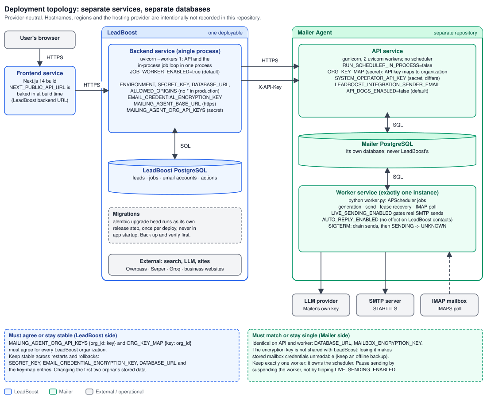

# Deployment Guide

This guide describes the **intended deployment topology** and the **configuration each service requires**. It is
provider-neutral on purpose: it states what must be true, not which hosting product provides it.



*Diagram: [`leadboost-deployment-topology.svg`](diagrams/leadboost-deployment-topology.svg).*

| Service | Instances | Notes |
|---|---|---|
| Frontend (`frontend-react/`, Next.js 14) | any | `NEXT_PUBLIC_API_URL` baked in at build time |
| LeadBoost backend (`backend/`) | **one** | API and the in-process job loop share the process; own PostgreSQL |
| Mailer API (separate repository) | 1+ | `gunicorn` with 2 uvicorn workers; no scheduler in this process |
| Mailer worker (separate repository) | **exactly one** | Owns the scheduler; shares the Mailer's PostgreSQL with the API |

> **Deployment and verification status.** The frontend, the LeadBoost backend, the Mailer API and the Mailer worker
> are deployed as separate services. The operator reports them running, with the worker observed separately from
> the APIs. Hostnames and hosting-console settings (root directory, environment values, release or pre-deploy
> command) are managed in the hosting console and are intentionally not published; record them in your own
> operations notes. This repository defines the topology and configuration requirements; it does not create or
> modify the hosted services. A hosted delivery acceptance record (dispatch receipt plus a message received in a
> recipient mailbox) is not included, so delivery to a real inbox is not asserted. See
> [`SYSTEM_DESIGN.md`](SYSTEM_DESIGN.md) §15.

The Docker and Compose artifacts (`Dockerfile`, `docker-compose.yml`, `docker-compose.prod.yml`,
`deploy/nginx.conf`) serve local development and an optional self-hosted path; see the end of this document.

## LeadBoost backend service

1. **Web service** built from this repository's `Dockerfile` (no separate build or start command is needed; the
   Dockerfile's own `CMD` starts the app).
   **The Docker build context must be `backend/`** (set the service's root
   directory to `backend`): the Dockerfile does `COPY requirements.txt .` and
   `COPY . .` relative to that directory. Inside the image everything lives in
   `/app` -- `alembic.ini`, `alembic/`, `scripts/` and `main.py` are all at
   `/app/...` (checked against `backend/Dockerfile` and `.dockerignore`; there is
   no `/app/backend`). The image binds port **8000** in its `CMD` (it does not
   read `$PORT`); make the platform's routing target port 8000.

2. **Instance size**: the backend was tuned for roughly 512 MB of RAM; see `docs/DOCKER.md` for Playwright's
   memory footprint. Start small; move up only on actual memory pressure in your platform's metrics.

3. **Environment variables** (your platform's secret/environment settings): set
   every variable listed as "required" in `docs/ENVIRONMENT.md`, at
   minimum:
   - `ENVIRONMENT=production`
   - `SECRET_KEY` — a real random value. **The app will refuse to start
     in production with the placeholder value or anything under 32
     characters** (see `core/config.py`) -- this is intentional, not a
     bug to work around.
   - `DATABASE_URL` — a managed PostgreSQL connection string (must start with `postgresql://`; the app also
     refuses to start on sqlite in production). Never commit it.
   - `ALLOWED_ORIGINS` — your actual frontend origin(s), comma
     separated. Never `*` in production (also enforced at startup).
   - `EMAIL_CREDENTIAL_ENCRYPTION_KEY` — encrypts stored email-account
     credentials; keep it stable (changing it makes stored credentials
     unreadable).
   - `MAILING_AGENT_BASE_URL`, `MAILING_AGENT_ORG_API_KEYS` — the server-to-
     server link to the deployed Mailer; see "Connecting to the Mailer Agent"
     below. Without them every dispatch fails closed (it never falls back to
     anything).
   - `GROQ_API_KEY`, `SERPER_API_KEY` — optional but recommended; AI
     enrichment/qualification/outreach and the website-resolution
     fallback both degrade to deterministic behavior without them, they
     don't error.

4. **Health checks** (`backend/main.py`):

   | Route | Checks | Use it for |
   |---|---|---|
   | `/live` | nothing (static `{"status":"alive"}`) | the platform health check and the image `HEALTHCHECK` |
   | `/ready` | database (`SELECT 1`); 503 if it fails | readiness / your own monitoring |
   | `/health` | database **and Redis**; 503 if either fails | humans only -- never as the platform check |

   `/live` does **not** prove the database or the background job loop are
   healthy. No route reports the job loop's state; a stuck loop is visible only
   as `jobs` rows that stay claimable/leased.

5. **Redis**: only used today as a legacy Celery broker health-check
   target (`/health`'s Redis check) -- the active lead pipeline is
   LangGraph-based, not Celery-based, and doesn't require Redis to
   function. If you don't run a Redis instance (the broker URL defaults to
   `redis://localhost:6379/0`), `/health` returns **HTTP 503 permanently** even
   though the API works fine -- another reason not to use it as the platform
   check. Either provision a
   small managed Redis or ignore that one health-check field.

### Process model (one process, in-process job loop)

The image runs **one** Uvicorn process (`--workers 1`). Its `lifespan` starts the
in-process job loop (`application/execution/worker_loop.py`) when
`JOB_WORKER_ENABLED` is not `false`/`0`/`no` (**default: enabled**). The loop
executes the durable `LEAD_PIPELINE` jobs that `POST /leads` creates. If it is
disabled and nothing else runs it, new leads are saved and their jobs queue but
**never run** -- so leave it enabled on the single web service. Do not add a
separate worker service.

* Claiming is atomic (`job_repository.try_claim`) with periodic lease reclaim, so
  an accidental second instance cannot double-run a job; the process is still
  designed to be single.
* Settings (read from the environment, see `docs/ENVIRONMENT.md`):
  `JOB_WORKER_ENABLED` (default `true`), `JOB_WORKER_CONCURRENCY` (default `3`),
  `JOB_POLL_INTERVAL_SECONDS` (default `2`, minimum `0.5`).
* Capacity: concurrency 3 alongside Playwright on a ~512 MB instance is a
  memory risk. Watch the memory metric; change `JOB_WORKER_CONCURRENCY`
  only on evidence.
* Shutdown: `stop()` signals the loop and waits up to 10 s; unfinished work is
  recovered by lease reclaim on the next start.

## Connecting to the Mailer Agent

LeadBoost calls the **deployed** Mailer API from the backend only; the browser
never calls the Mailer and must never receive a Mailer URL or key
(`core/infrastructure/mailing_agent/client.py`).

| Variable | Required | Meaning |
|---|---|---|
| `MAILING_AGENT_BASE_URL` | yes | Base URL of the deployed Mailer API. Must be `https://`; plain `http://` is accepted only for loopback hosts (any other value fails closed with `INSECURE_TRANSPORT`, before any request) |
| `MAILING_AGENT_ORG_API_KEYS` | yes | JSON object `{"<leadboost_org_id>": "<mailer_api_key>"}`. One key per LeadBoost organization; a missing org fails closed (`AUTH_NOT_CONFIGURED`). Invalid JSON / non-object is logged and yields no usable keys |
| `MAILING_AGENT_TIMEOUT_SECONDS` | no | Positive number; default `15` |

* `MAILER_AGENT_BASE_URL` and `MAILING_AGENT_API_KEY` are **not** read.
* The Mailer's `ORG_KEY_MAP` is the **inverse** shape, `{"<mailer_api_key>":
  "<mailer_org_id>"}`. Both sides must agree per organization. The Mailer derives
  the organization from the key; LeadBoost never sends an organization id in a
  request body.
* Redirects are not followed (httpx default), and failures are logged by type
  only, never with request content or the key.
* Whether the deployed values agree is **not verifiable from this repository**;
  it is proven only by an authenticated request to the deployed Mailer.
* `/mailer-state` is read-only: it never heals, retries or overwrites Mailer
  delivery state.

## Mailer services (summary; the runbook is canonical)

The Mailer is operated from its own repository. Its authoritative procedure is
[`C13_DEPLOYMENT_RUNBOOK.md`](https://github.com/anupamkr1708/LeadBoost-mail-agent/blob/main/docs/C13_DEPLOYMENT_RUNBOOK.md).
What LeadBoost operators need to know:

| Requirement | Detail |
|---|---|
| Two processes, one database | **API** (`gunicorn` + uvicorn workers, `RUN_SCHEDULER_IN_PROCESS=false`) and **worker** (`python worker.py`, exactly one instance), both on the Mailer's own PostgreSQL |
| Identical on API and worker | `DATABASE_URL`, `MAILBOX_ENCRYPTION_KEY` (losing it makes stored mailbox credentials unreadable; keep an offline backup) |
| Tenant auth | `ORG_KEY_MAP` `{key: org_id}`, agreeing with LeadBoost's `MAILING_AGENT_ORG_API_KEYS` |
| Operator auth | `SYSTEM_OPERATOR_API_KEY`, a different secret from every tenant key; never given to LeadBoost |
| First dispatch | `LEADBOOST_INTEGRATION_SENDER_EMAIL` must be set, or the first dispatch for an organization returns 503 |
| Real sending | `LIVE_SENDING_ENABLED` on the worker gates actual SMTP sends |
| Pausing sends | Suspend the worker. Do not flip `LIVE_SENDING_ENABLED` as a pause |
| Public surface | The API's interactive docs are disabled unless `API_DOCS_ENABLED=true` |

Verifying the link is an authenticated request from the deployed LeadBoost to the deployed Mailer, never a file
in either repository. This guide records no result of such a check.

### A stranded `dispatching` action

If the LeadBoost process dies after an action is claimed (`approved → dispatching`) and before the Mailer answers,
the action can stay `dispatching`. There is no automatic reclaim and no supported API to reset it, and a
`dispatching` action cannot be cancelled. Before anything else, read the Mailer's view for that action with
`GET /api/v2/outreach-actions/{id}/mailer-state`: if the Mailer reports a dispatch, the request was accepted;
if it reports `not_found_at_mailer`, it was not. Resolving the LeadBoost row is an operator decision made with
the maintainers; do not create a duplicate action to "force" a send.

## Frontend service

The frontend source **is** in this repository: `frontend-react/` (Next.js 14).
(An earlier version of this guide said otherwise; that was stale.)

1. Build from the **`frontend-react`** subdirectory of this monorepo (set the project's root directory
   accordingly).
2. Set `NEXT_PUBLIC_API_URL` to the LeadBoost **backend's** public `https://` URL.
   It is read at **build time** and baked into the browser bundle; the default
   when unset is `http://localhost:8000`, so a missing value ships a build that
   calls localhost. Changing it requires a rebuild.
3. Put that exact frontend origin (scheme + host, no trailing slash; include
   preview origins only if you use them) in the backend's `ALLOWED_ORIGINS`.
4. Do not add any Mailer URL or key to the frontend. Today the browser only
   consumes LeadBoost's own read-only `GET /api/v2/outreach-actions/{id}/mailer-state`
   view (`src/types/api.ts`, `mailer-state-panel.tsx`); there is no Mailer host or
   key in `src/`. (`mailing_agent_reference`, an opaque string, is still present in the browser-facing `OutreachAction` type, a
   known review item.)

`FRONTEND_URL` is consumed only by the dormant Stripe return-URL code; it is not
needed for the current flow.

## Database migrations

Alembic (`backend/alembic/`) is the canonical mechanism for all *future*
schema changes. `init_db()` (`main.py`'s `lifespan`, calling
`Base.metadata.create_all()`) still runs on every startup, but as of P1.1
its role is narrower: it's a convenience for tests and fresh local/dev
databases with nothing in them yet, not the production schema-evolution
mechanism. `create_all()` only ever adds missing tables -- it never alters
an existing table (add a column, add a constraint) -- so once a database
has any real data in it, Alembic is the only thing that can safely move
its schema forward.

**Historical note:** `backend/migrations/001_p0_durable_execution.sql` is
the hand-written SQL that took a pre-P0 database to the P0 schema. It is
preserved as-is, for history -- it is not run again, and it is not a
second migration system running alongside Alembic. See the note added to
its own header. Do not add a `002_*.sql` file next to it; use Alembic.

### Everyday workflow (developer machine)

1. Change an ORM model in `core/domain/models/` (or, less commonly,
   `application/observability/models.py`).
2. Generate a revision:
   ```
   cd backend
   alembic revision --autogenerate -m "describe the change"
   ```
3. **Open the generated file in `alembic/versions/` and read it.** Never
   commit autogenerate output unread. Look specifically for anything you
   didn't expect: a `drop_table`/`drop_column` you didn't intend, a type
   change on an unrelated column, a duplicate index. Autogenerate is a
   diffing tool, not a decision-maker.
4. Apply it locally: `alembic upgrade head`
5. Run the backend test suite: `python -m pytest`
6. Commit the ORM change and the migration file together, in the same PR.

Useful commands while working on a migration:

| Command | Shows |
|---|---|
| `alembic current` | the revision your local database is actually at |
| `alembic heads` | should always print exactly one revision |
| `alembic history` | the full chain of revisions, oldest to newest |
| `alembic check` | whether the database still matches the ORM models (no pending changes) |

### Existing-database adoption -- read this before ever running `alembic stamp`

`alembic stamp <revision>` records "this database is already at
`<revision>`" **without running any DDL at all**. That's exactly what you
want when adopting a database that a prior process (`create_all()`, or
historically, `001_p0_durable_execution.sql`) already built to match the
current schema -- running the baseline revision's `CREATE TABLE`
statements against it would just fail on "already exists" errors. But
stamping a database whose schema *doesn't* actually match is worse than
doing nothing: Alembic will believe the migration history and the real
database agree from then on, when they don't, and nothing will
surface that until something breaks in production.

**So: never run `alembic stamp` against a database you haven't verified.**
The required procedure is:

```
cd backend
DATABASE_URL=<the database you're adopting> python scripts/verify_baseline_schema.py
```

This script reflects the live database and compares it, table by table
and column by column, against the current ORM models -- including named
checks for `uq_leads_org_website` and every P0 column from
`001_p0_durable_execution.sql`. It exits `0` only if everything matches.

- **Exit code 0** ("Schema verification passed"): safe to run
  `alembic stamp eaa40e596fcc` (the baseline revision ID), then
  `alembic upgrade head` (a no-op, since you're already at head).
- **Exit code 1**: **do not stamp.** The script prints exactly what's
  missing or mismatched. Bring the database to the expected schema
  through an explicitly reviewed migration/procedure, or -- for a
  database you don't actually need to keep -- discard it and start a
  fresh one with a normal `alembic upgrade head` instead.

**There is currently no verified, live production database this has been
run against.** If/when a real production database needs to be adopted,
run `verify_baseline_schema.py` against it first, exactly as above, before
ever stamping it -- and back it up first regardless of what the script
says.

### Testing migrations

`tests/infrastructure/test_alembic_metadata.py` needs no live database
(pure metadata inspection) and runs as part of the normal suite.
`tests/infrastructure/test_alembic_postgres_migrations.py` actually runs
`alembic upgrade`/`stamp`/`check` against real, disposable PostgreSQL
databases it creates and drops itself -- it's skipped by default and only
runs when `ALEMBIC_TEST_DATABASE_URL` is set to a Postgres server you're
comfortable letting it create/drop databases on:

```
docker-compose up -d postgres   # already defined in backend/docker-compose.yml
export ALEMBIC_TEST_DATABASE_URL="postgresql://<user>:<password>@localhost:5432/postgres"   # a disposable local server
python -m pytest tests/infrastructure/
```

### Production

Run `alembic upgrade head` as a **separate deploy step that happens once
per deploy**, before the new application code starts serving traffic --
never inside FastAPI's `lifespan`/startup. With a single backend instance
that is one run either way, but the app should never assume that: `alembic upgrade head` racing against itself from
multiple starting replicas is exactly the failure mode a release-step
migration avoids, and there's no reason to give it up.

> **Do not enable the pre-deploy command on an existing database yet.** A
> database that already holds data must first be adopted (verified, then stamped)
> as described in "Existing-database adoption" above. Enabling `alembic upgrade
> head` against an unadopted schema would try to re-create existing tables and
> fail. No live LeadBoost database has been verified or adopted by this
> repository; the adoption state is an operator-only fact.

Use your platform's **release / pre-deploy hook** if it has one (it should run once per deploy, before the new
version serves traffic, and a failure should cancel the deploy). It runs inside
the **built image**, whose working directory is `/app` (where `alembic.ini`
lives), so for the Docker service built from `backend/` the command is:

```
alembic upgrade head
```

The earlier suggestion `cd backend && alembic upgrade head` is only correct when
run from a repository-root checkout (CI, a developer machine); inside the image
there is no `/app/backend`, and it would fail. (Not yet exercised in a deployed
container; CI runs the migration from `backend/` against a fresh PostgreSQL.)

Order matters on a **fresh** database: run the migration before the first app
start. The app's startup `create_all()` would otherwise create the tables first,
and the baseline revision would then fail on "already exists".

Whatever the mechanism, do not add
`alembic upgrade head` to the Dockerfile's `CMD` or to `main.py`'s
`lifespan`: both run once per replica, which is exactly what a release-
step migration is meant to avoid.

For the self-hosted/VPS `docker-compose.prod.yml` path (below), run
`alembic upgrade head` manually (or via a one-shot deploy script) before
restarting the `backend` service -- there's no separate release-step
hook in a plain Compose setup.

## Release and rollback

* **Identify the deployed version:** your platform's deploy history shows the commit each service is running;
  check the backend and the frontend separately.
* **App rollback does not roll back the schema.** Redeploying an older commit
  leaves the database at whatever Alembic revision it reached. Old code against
  a newer schema is only safe if every migration since was additive; check each
  revision before relying on it. There is no automated `alembic downgrade` in
  the release flow, and none should be run against a database with customer data.
* **Before any migration on a persistent database:** take and verify a backup.
  A schema fix is a forward migration or a restore, not a code rollback.
* **Keep stable across restarts and rollbacks:** `SECRET_KEY`,
  `EMAIL_CREDENTIAL_ENCRYPTION_KEY`, `DATABASE_URL`, and the
  `MAILING_AGENT_ORG_API_KEYS` entries (which must keep matching the Mailer's
  `ORG_KEY_MAP`).
* **Sending:** LeadBoost does not hold delivery state; to stop new sends
  safely, follow the Mailer's pause procedure (suspend its worker -- never
  `LIVE_SENDING_ENABLED=false`) in the Mailer repository's
  `docs/C13_DEPLOYMENT_RUNBOOK.md`. Never retry or reset a dispatch from
  LeadBoost: `UNKNOWN` outcomes are not auto-resent.

## Billing

Stripe is intentionally **not** wired up to actually process payments yet
(see `core/infrastructure/billing/stripe_service.py`, which is a ready,
unused scaffold, and PART 8 / SECTION 10 of the brief). The `/upgrade`
endpoint always returns "Online payments coming soon" without changing
anyone's plan. Manually moving an organization to Pro/Enterprise today
means calling `SubscriptionService.assign_plan_to_organization` directly
-- e.g. from a one-off script or a shell into the running container --
which is deliberately not exposed over the API to any regular user.

## Optional: self-hosted / VPS deployment

If you'd rather run everything on a single VPS instead of managed services:

```bash
cp .env.example .env   # fill in real values
docker compose -f docker-compose.prod.yml up -d
```

This brings up the backend, Postgres, Redis, MinIO, pgAdmin, Prometheus,
and Grafana (see `docs/DOCKER.md` and `docs/MONITORING.md`). Put
`deploy/nginx.conf` (with a real domain and TLS certs) in front of it for
TLS termination and basic edge rate-limiting -- see the comments in that
file.
