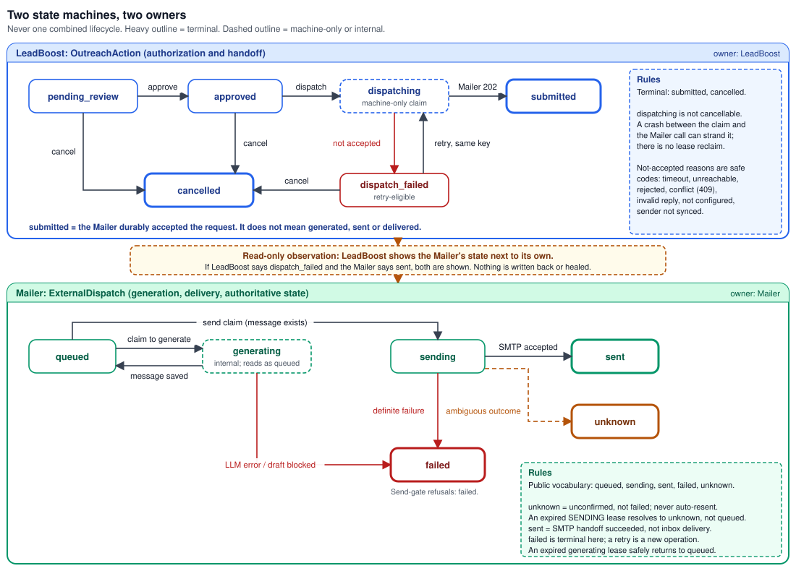

# LeadBoost System Design

The end-to-end design of LeadBoost and its integration with the separately deployed Mailer Agent, including
the trade-offs the implementation accepts. This document explains *why*; it does not catalogue every class.
Subsystem detail lives in [`DISCOVERY.md`](DISCOVERY.md), [`ARCHITECTURE_FULL.md`](ARCHITECTURE_FULL.md) and
[`MAILER_INTEGRATION.md`](MAILER_INTEGRATION.md). The short version is [`ARCHITECTURE.md`](ARCHITECTURE.md).

Every statement here was checked against the code and tests at the time of writing. Where a statement is a
design intent that the code only partly enforces, it says so.

## 1. Goals and non-goals

**Goals**

* Turn a plain-language request ("top shoe stores in Mumbai") into **verified, qualified leads** with an
  explainable trail.
* Keep customer authorization and business context in one control plane, and put message writing, sending
  and conversation tracking in a **separate service** that can fail, scale and be operated independently.
* Never invent facts: a website that cannot be verified is reported as unresolved, not guessed.
* Make every external side effect **durable and idempotent**, and make the unavoidable ambiguity (SMTP)
  explicit instead of hiding it.

**Non-goals (today)**

* Exactly-once email delivery, or observing delivery to the recipient's inbox.
* Horizontal scale-out of the LeadBoost job loop, or of the Mailer worker.
* A per-customer sender identity on the Mailer beyond the mailbox itself (see §17).
* Automatic Mailer-side follow-ups or auto-replies for LeadBoost-authorized contacts.
* A distributed transaction or automatic cross-service healing.

## 2. High-level architecture


*[`leadboost-system-context.svg`](diagrams/leadboost-system-context.svg)*

Two services, two databases, one narrow HTTP seam. LeadBoost is the customer-facing **control plane**; the
Mailer is the **communication plane**. The browser talks to LeadBoost only.

## 3. Component and dependency boundaries

| Boundary | Rule | Why |
|---|---|---|
| `api → application → core` | Routers call services; services call infrastructure adapters; one known exception (`scoring.py` imports a DTO) | Keeps HTTP concerns out of business rules |
| Mailer access | Three clients in `core/infrastructure/mailing_agent/` (`client.py` dispatch, `mailbox_client.py`, `conversation_client.py`); routers never call them directly | One place enforces HTTPS, no redirects, key selection, closed error vocabulary |
| Discovery | Pure building blocks; only `discovery_service.py` touches the database and the pipeline | Each stage is testable with stub providers and zero network |
| LeadBoost ⇄ Mailer | HTTP only; no shared code, model or key | Independent deployment and failure domains |

## 4. Discovery request lifecycle

`POST /api/v2/discovery/search` runs, in the request, as an inline `DISCOVERY` job (a durable `jobs` row that is
created and executed immediately):

1. **Parse** the query with a deterministic, regex-based parser (no LLM). An unparseable query raises HTTP 422 Unprocessable Entity (`HTTP_422_UNPROCESSABLE_ENTITY`) through the endpoint's `QueryParseError` handler.
2. **Search.** Overpass (OpenStreetMap) is always tried first. Only when it returns zero candidates does a
   general web-search provider (Serper) run, for *any* category, because map data misses SaaS companies,
   agencies and freelancers.
3. **Normalize**, **resolve and validate the official website**, **deduplicate**, **rank** (§5).
4. **Create leads** (organization-scoped, quota-aware) and run the qualification pipeline (§6) per lead,
   with a bounded worker pool, catching failures per business so one crash never aborts the batch.

Leads can also be created directly (`POST /api/v2/leads`), in which case each lead gets a durable
`LEAD_PIPELINE` job picked up by the job loop (§7).

*Trade-off:* discovery executes inside the HTTP request for responsiveness and simplicity, so a long query
holds a connection and a slice of the API process. The job row still makes the work auditable.

## 5. Identity resolution and validation

The goal is the **official website** of a business, not "a website". The flow is layered so each stage only sees
the previous stage's output:

```
raw provider data → Evidence → Features → Verification → Confidence → Business identity
                                   → identity-resolution engine → Verified Digital Identity → ranking
```

* **Validation** requires a reachable HTML page with a final 200 status after redirects, and rejects
  directory/social/marketplace domains, including when a dead business domain is parked and redirected into one.
* **Resolution** prefers the provider's own website, validated; otherwise the fallback resolver proposes a
  candidate whose domain is not a directory and plausibly matches the name, and that candidate is validated too.
* **Competition and conflict handling** compare candidate websites; organization consolidation and
  false-positive signals adjust a *diagnostic* confidence. They never silently change which website was selected.
* **Never fabricated:** if nothing verifies, the website is `None` and the business is reported with a reason.
* **Ranking** is deterministic and explainable (website verification strength, category and location match,
  domain/name similarity, contact completeness, selection stability). It only decides which validated
  businesses survive when there are more than the requested limit.

*What it does not guarantee:* that the resolved site is the right company. The benchmark (§15) measures
validation and resolution *success*, not human-labeled correctness. *Trade-off:* a purely deterministic stage is
reproducible and testable but cannot use semantic judgement an LLM could add.

## 6. Qualification pipeline

A LangGraph workflow runs per lead: scrape (tiered), enrich, score, decide, draft. Enrichment is a **waterfall**:
(1) deterministic enrichment from the site's own structured data, with fields omitted rather than guessed; (2) an
external-API tier that is currently a placeholder; (3) an LLM only as a last resort for what the deterministic tier
could not determine. AI-assisted steps use an LLM when configured and **fall back to deterministic or heuristic
paths** when the key is absent or a call fails, so the pipeline still completes, with less intelligence. Inputs are grounded in scraped, real fields;
outputs carry an explanation and are logged. This reduces, but does not eliminate, the chance of a wrong
inference, and nothing here promises zero hallucinations. Pipeline status (including failures) is persisted on
the lead and in the jobs table.

## 7. Persistence and background execution

* **Database:** PostgreSQL in production (SQLite for development). `create_all` still adds missing tables on
  startup; schema *changes* are Alembic revisions (five), validated against PostgreSQL in CI and applied as a
  deliberate release step, never automatically (see [`DEPLOYMENT.md`](DEPLOYMENT.md)).
* **Job loop:** one `asyncio` task in the API process polls `jobs` (default every 2 s, concurrency 3). A claim is
  an atomic conditional update that takes a 300-second lease; `attempt_count` increments on each claim and
  `max_attempts` defaults to 3. Expired leases are swept: back to `PENDING` while attempts remain, else
  permanently `FAILED`. A finished job's completion is fenced by worker id, so a worker whose lease was reclaimed
  cannot overwrite the new owner's result.
* **Why in-process:** the durable table gives crash-safety without a broker; one process keeps operations simple.
  *Trade-off:* the loop shares the API's fate and cannot scale independently (§17). `JOB_WORKER_ENABLED=false`
  turns the loop off for an API-only process.

## 8. LeadBoost-to-Mailer integration lifecycle


*[`leadboost-mailer-lifecycle.svg`](diagrams/leadboost-mailer-lifecycle.svg)*

Five phases: **A** sender setup and mailbox sync, **B** authorization and dispatch, **C** generate and send
(Mailer worker), **D** reply intake, **E** read-only conversation view. LeadBoost's responsibility ends at
*durable acceptance*; everything after belongs to the Mailer. The contract is explained in
[`MAILER_INTEGRATION.md`](MAILER_INTEGRATION.md).

## 9. Authentication and tenant isolation

* Users authenticate to LeadBoost; every outreach and account route is organization-scoped, and a request for
  another organization's action returns 404.
* LeadBoost authenticates to the Mailer with `X-API-Key`, **one key per LeadBoost organization**. The Mailer
  alone maps key → organization (`ORG_KEY_MAP`). Bodies carry no tenant and nothing in a body authorizes.
* No key for an organization fails closed. A shared key is not accepted by design, because it would merge customers.
* The Mailer's operator credential is a separate secret on separate routes. A tenant key never reaches them.
* Inbound mail is bound to the polled mailbox's organization before content is read; nothing in a message
  (From, To, Subject, Message-ID) selects or widens the tenant.

*Not guaranteed:* automated key provisioning (operator-managed), and a per-customer sending domain beyond the
mailbox.

## 10. Database boundaries and data ownership

| Data | Owner | Never crosses |
|---|---|---|
| Leads, qualification, jobs, actions, policy, LeadBoost's encrypted SMTP copy | LeadBoost DB | Mailer cannot read it |
| Mailbox + encrypted credential, dispatches, contacts, messages, suppression | Mailer DB | LeadBoost cannot read it |
| Encryption keys | One per service | Never transmitted |

LeadBoost's only view of Mailer data is the bounded, schema-validated conversation endpoint (§12, §14).

## 11. Idempotency, retries, timeouts and duplicate prevention

| Mechanism | Where | Guards against | Does not guard against |
|---|---|---|---|
| Idempotency key on the action (caller-supplied or derived from the authorization snapshot) | LeadBoost `create_action` | A repeated create producing two actions; a key reused for a different request is rejected | |
| Atomic `approved → dispatching` claim | LeadBoost | Two concurrent dispatches of one action | A crash after the claim (action can stay `dispatching`; no lease reclaim) |
| Same key forwarded to the Mailer | Mailer intake | A retry after a lost response creating a second dispatch (the original is replayed) | A replay of an already-`failed` dispatch; that needs a new operation |
| 15-second default timeout, closed error codes | LeadBoost clients | Hanging requests; leaking raw errors | Knowing whether the Mailer accepted after a timeout |
| `(mailbox, Message-ID)` dedupe | Mailer inbound | Re-processing the same inbound email | |
| Fenced job completion | LeadBoost jobs | A reclaimed worker overwriting the new owner | |

*Design choice:* retries are always safe **at the dispatch layer**. They are deliberately **not** applied to the
SMTP layer.

## 12. Durable dispatch and state transitions



*[`leadboost-outreach-state-machine.svg`](diagrams/leadboost-outreach-state-machine.svg)*

Two independently owned state machines, never merged:

* **LeadBoost `OutreachAction`:** `pending_review → approved → dispatching → submitted`, with `dispatch_failed`
  (retry-eligible, cancellable) and `cancelled`. `submitted` and `cancelled` are terminal. `dispatching` is
  machine-only and not cancellable.
* **Mailer `ExternalDispatch`:** `queued → (generating, internal) → queued → sending → sent | failed | unknown`.
  The public vocabulary is `queued | sending | sent | failed | unknown`.

The Mailer commits intake in **one** transaction before answering `202`, so "accepted" survives a crash. Generation
and send claims use leases and fencing tokens so a stalled worker cannot act on a row another worker owns.

## 13. SMTP sending and ambiguous outcomes

An SMTP conversation cannot be made transactional. If a failure occurs during or after the `DATA` phase the
server may or may not have taken the message. The Mailer therefore classifies every attempt as `sent`, `failed`
(definitely not sent, safe to retry as a new operation) or `unknown` (**never auto-resent**). An expired send
lease resolves to `unknown`, never back to `queued`. On shutdown the worker drains in-flight sends for a bounded
period and moves anything still owned to `unknown`.

*Trade-off accepted:* a possible missed send (surfaced as `unknown`, for a human to decide) in exchange for no
duplicate emails to a prospect. `sent` means the SMTP server accepted the message, not that it reached an inbox.
`LIVE_SENDING_ENABLED` gates real sends; pausing is done by suspending the worker.

## 14. IMAP reply ingestion and conversation reconstruction

Each ACTIVE mailbox with complete IMAP settings is polled (default 120 s) using **its own** encrypted credential;
nothing falls back to a deployment-global identity. A message is fetched with `BODY.PEEK`, processed in its own
transaction, committed, and only then marked Seen, so a crash re-delivers rather than loses it.

Correlation is organization- and mailbox-scoped: RFC `In-Reply-To`/`References` against stored messages first;
otherwise the sender address, but only if exactly one non-suppressed contact has it. **Ambiguous or unmatched mail
is not persisted and not guessed.** Persisted replies are classified and update contact state; an unsubscribe
adds the contact to the organization's suppression list. For LeadBoost-authorized contacts the Mailer does not
send automatic follow-ups or auto-replies (enforced in the Mailer and covered by its isolation tests); native
follow-ups and auto-replies exist for Mailer-native campaigns only.

A **conversation is per recipient, not per action.** LeadBoost reconstructs the view from one read-only,
bounded endpoint (section 3 of [`CONTRACT.md`](../core/infrastructure/mailing_agent/CONTRACT.md)): most recent N messages, bodies capped, third-party text shown as plain
text, inbound limited to mail received through a mailbox owned by the organization.

## 15. Observability, evaluation and operational health

* **Health:** the API exposes liveness/readiness style endpoints; the public health output is deliberately minimal.
  Details and troubleshooting are in [`MONITORING.md`](MONITORING.md); pipeline instrumentation in
  [`OBSERVABILITY_AND_METRICS.md`](OBSERVABILITY_AND_METRICS.md).
* **Logging** carries organization, lead and job identifiers; credentials never appear in logs or responses.
* **Discovery evaluation harness** (`backend/discovery_eval/`): 113 fixed queries run through the real discovery
  flow. The committed report (generated 2026-08-04) shows 581 businesses found, 87.4% validation success,
  88.8% website-resolution success, 1.4% duplicate rate and 100% query-parse success. These measure **automated
  success**: "resolved" means a candidate website was found, not that a human confirmed it; the manual-review sheet
  (511 rows) is unlabeled, and in that run every candidate was attributed to the Serper fallback. The corpus covers
  the categories and cities in `queries.py` only; it does not represent production traffic.
* **Tests:** unit and service tests run in CI against SQLite; a separate job validates Alembic on PostgreSQL; a
  cross-service job checks out the Mailer at a **pinned commit** and runs it in its own virtualenv. The
  continuous lifecycle test drives the real LeadBoost API and client, a separate Mailer API process on a
  disposable PostgreSQL database, the Mailer's real generation, dispatch and IMAP-poll cycle functions (run one at
  a time, not as the long-running scheduler), a STARTTLS SMTP sink, a throw-away Dovecot IMAP server and the
  Mailer's existing deterministic fake LLM. It includes an operator step that sets disposable IMAP settings. Its destructive-database guard requires
  `C12_ALLOW_DESTRUCTIVE_TEST_DB=1` and a loopback database named `mailer_agent_test`.

**Verification levels.** The evidence for the integrated system comes from different sources, which are recorded
separately and are not interchangeable:

| Level | Scope | Status |
|---|---|---|
| CI-verified (synthetic) | The cross-service lifecycle test described above | Runs in CI on pushes and pull requests to `main` and `develop`; no real recipient inbox is involved |
| Operator-reported (local) | End-to-end runs of the integrated system on a local setup | Reported by the operator; run records are not part of this repository |
| Operator-reported (hosted API) | The LeadBoost API and frontend and the Mailer API deployed as separate services and running | Reported by the operator; hostnames and hosting-console settings are intentionally not published |
| Operator-reported (hosted worker) | The Mailer worker deployed as its own single-instance service and running | Reported by the operator, recorded separately from the API |
| Hosted message delivery | Real email delivered to a recipient mailbox from the hosted deployment | No acceptance-test record (dispatch receipt and delivery evidence) is included, so delivery to a real inbox is not asserted |

The hosted rows describe the operator's observation of running services. They are not a delivery acceptance
test: a hosted acceptance record would consist of a dispatch receipt (the `202` and its idempotency key) plus
evidence of the resulting message in a recipient mailbox, and none is published with this repository.

## 16. Failure scenarios, consistency limits and recovery

| Failure | Behaviour | Recovery |
|---|---|---|
| Mailer unreachable at dispatch | `dispatch_failed` (`mailing_agent_unreachable`) | Retry (same key) |
| Timeout, acceptance unclear | `dispatch_failed` (`mailing_agent_timeout`) | Retry (same key); the Mailer replays |
| LeadBoost crash after claim | Action may stay `dispatching` | Operator investigates with the Mailer state, then resolves manually; no automatic reclaim |
| Mailer worker crash mid-generation | Lease expires, row returns to `queued` (no side effect yet) | Automatic |
| Mailer worker crash mid-send | Lease expires, row becomes `unknown` | Human decision; never auto-resent |
| Mailbox sync fails | Account `pending` with error code; new dispatch refused | Re-verify, edit, or `POST …/mailer-sync` |
| LeadBoost says failed, Mailer says sent | Both shown; nothing healed | Manual reconciliation |
| LLM/search provider outage | Discovery degrades to empty results; AI steps fall back to deterministic paths | Automatic when the provider returns |
| Mailer unavailable on a read | `availability = mailer_unavailable`, HTTP 200 | Automatic on next read |

**Consistency limits:** no distributed transaction; the windows are bounded by `mailer_sync_state` and by the
read-only nature of state views. **No exactly-once external delivery claim is made anywhere in this design.**

## 17. Scaling bottlenecks, constraints and future evolution

| Constraint | Today | Possible evolution |
|---|---|---|
| LeadBoost job loop | One in-process loop (concurrency 3) | Dedicated worker process; the lease/claim model already supports several workers |
| Discovery in-request | Holds a request open | Move to an async job with polling |
| Mailer worker | Exactly one instance (owns the scheduler) | Partition by organization or mailbox with leader election |
| `dispatching` strand | No lease reclaim | Add a lease and a reconciler that asks the Mailer for the true state |
| Conversation reads | Live call per view, no cache | Short-lived cache; keep the read-only rule |
| Sender identity | Display name and sender organization are deployment-wide on the Mailer | Per-organization identity provisioning |
| Inbound provenance | Webhook/global IMAP mail excluded | Close the provenance gap, then include |
| TLS | STARTTLS only | Implicit TLS support in the Mailer |
| Tenant keys | Operator-provisioned | Automated provisioning and rotation |
| Billing | No payment provider is wired up; the upgrade endpoint intentionally does not change a plan | Verified checkout + webhook flow |
